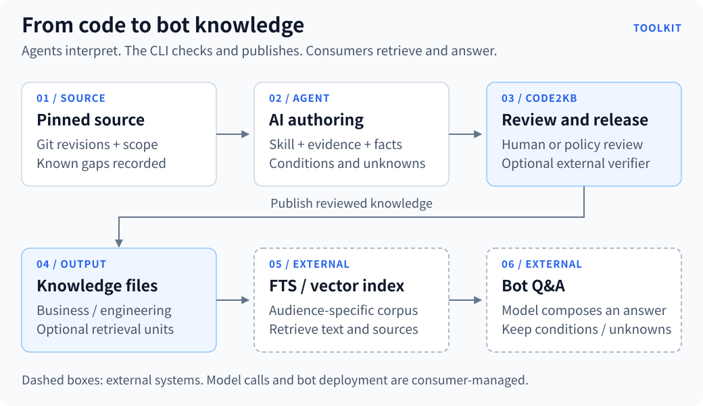
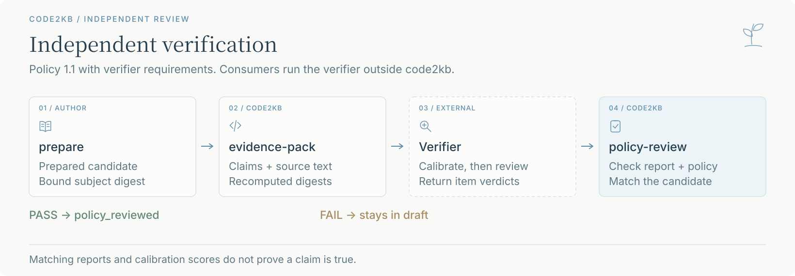
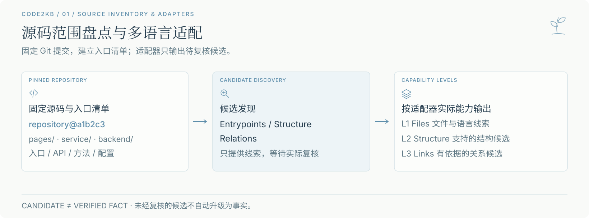
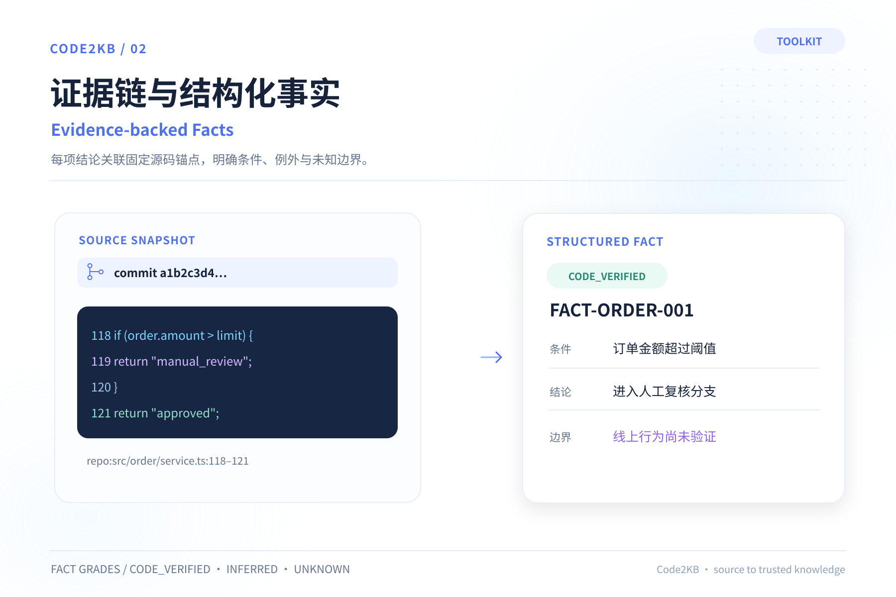
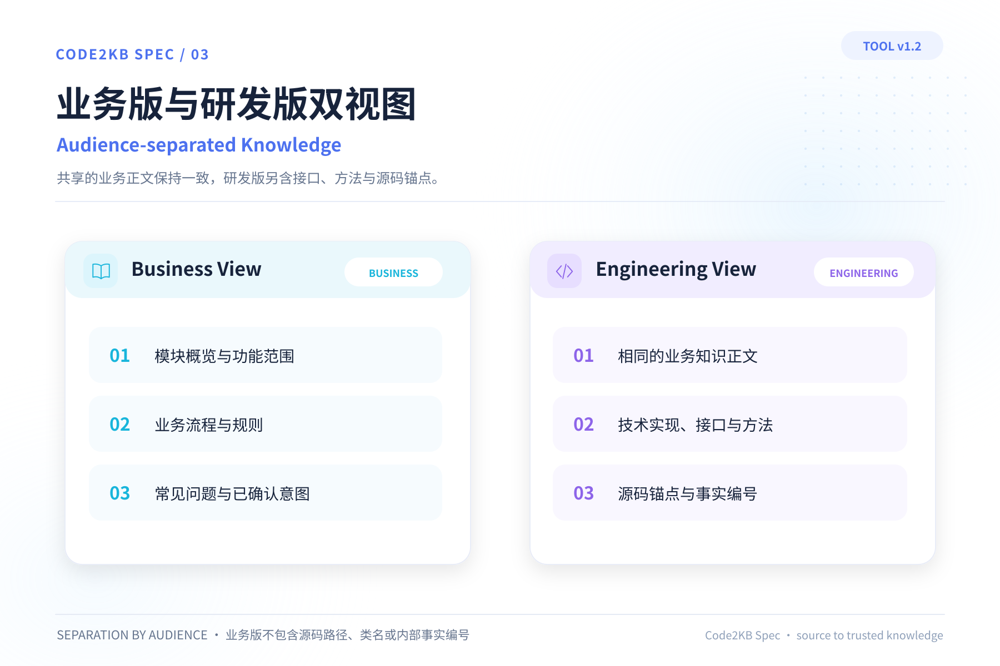
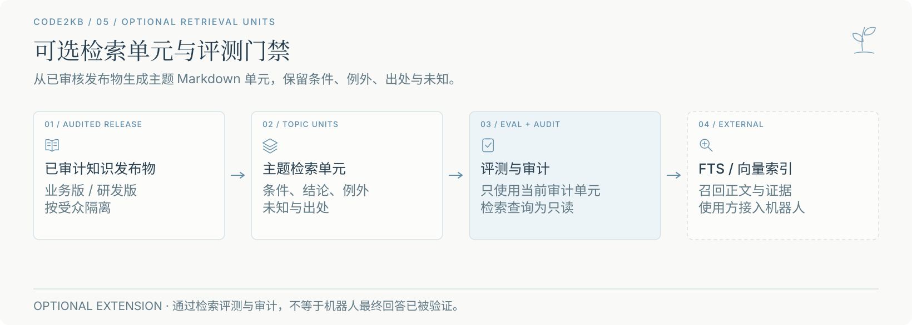
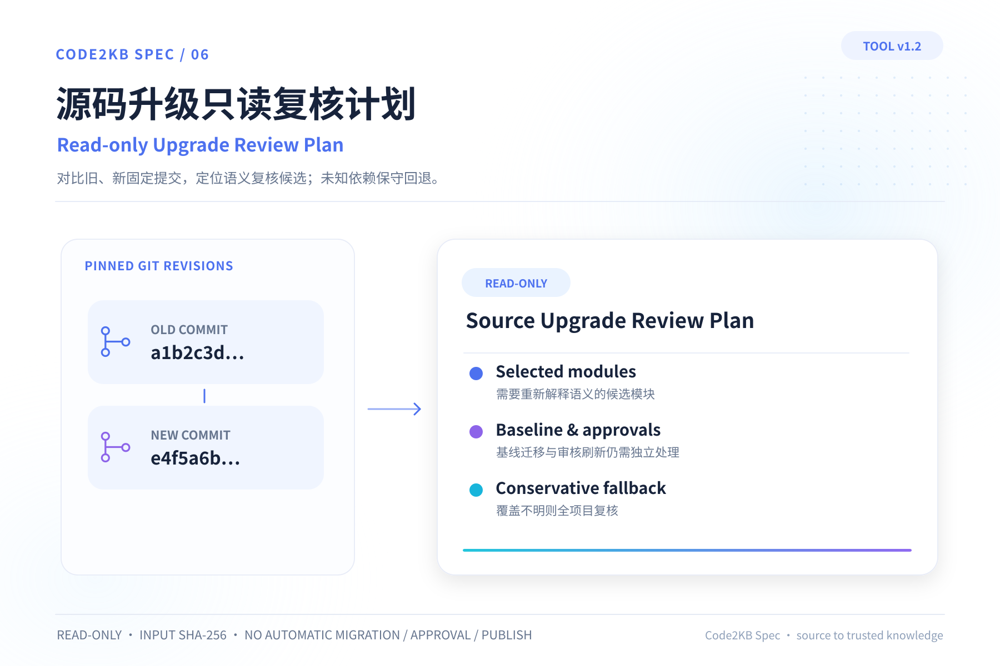

# Code2KB Agent Toolkit

[简体中文](README.md) · **English**

**Turn business rules in code into knowledge your bot can retrieve.**

Give your existing coding agent the source repositories, a defined scope and this toolkit. The agent traces code and writes features, workflows, rules and Q&A; `code2kb` checks evidence records, review state and release files so the knowledge can be maintained.

[Who it is for](#who-it-is-for) · [Outputs](#outputs) · [Quick start](#quick-start) · [FAQ](#faq) · [Documentation](#documentation)



## Who it is for

- **Business-system maintainers** who repeatedly inspect code to explain how a feature works.
- **Knowledge-base and bot builders** who need rules, workflows and limitations from an existing system.
- **Teams handing over or maintaining projects** who need explanations tied to fixed source revisions, with evidence and open questions.

Start with a clearly scoped module. Have the agent describe the scope and gaps before extracting knowledge; the first task does not need to cover the whole system.

## Outputs

| Output | Contents | Use |
| --- | --- | --- |
| **Business view** | Features, workflows, rules, limitations and Q&A | For business readers or a business bot's corpus |
| **Engineering view** | The same business text plus implementation, APIs, methods and source evidence | For developers to verify and maintain |
| **Internal knowledge source** | Functional inventory, structured facts, drafts and unresolved questions | For maintenance; keep it out of the business corpus |
| **Optional retrieval view** | Topic units from published text, preserving conditions, exceptions, unknowns and sources | Evaluate and audit before importing into external FTS or vector indexes |

Example text based on the bundled [order fixture](conformance/english/knowledge.md), not a production observation:

> **Q: Does signing in let me view every order?**
>
> A: In this example, signed-in users can only view orders in their assigned regions. Actual region assignments and production behavior have not been verified, so access for any particular account cannot be assumed.

A Q&A system uses **business knowledge → FTS/vector retrieval → model-composed answers**. You provide the index service, answer model and bot deployment. The evaluated retrieval extension has its own audit path; consumers who split base business files themselves check chunk boundaries, audience isolation and version switching.

## Quick start

Requires **Git, Python 3.9+**, and a coding agent that can read local repositories. Mutating commands require `fcntl` file locking on platforms such as Linux and macOS; other platforms can run read-only checks.

### 1. Install and select source revisions

Use a separate virtual environment. If the old package is installed, first run `python3 -m pip uninstall code2kb-spec` in that environment; both packages use the same command.

```bash
git clone https://github.com/Ethereal-Space-one/code2kb-agent-toolkit.git
cd code2kb-agent-toolkit
python3 -m pip install -e .
git init /path/to/knowledge-project
cp templates/知识库配置.example.json /path/to/knowledge-project/知识库配置.json
git -C /path/to/source-repo rev-parse HEAD
```

Keep the knowledge project separate from source repositories. Edit `知识库配置.json`: remove unused example repositories and set each absolute `path` and pinned `commit`. For English knowledge, set `content_language` to `en`; the default is `zh-CN`. See the [English guide](docs/usage.en.md).

### 2. Give the task to your agent

Replace the paths and scope, then send this task to your coding agent:

```text
Read <toolkit-root>/skills/extract-app-knowledge/SKILL.md and select the English workflow.
Use English interaction and content_language=en in /path/to/knowledge-project.
Agreed scope: <the whole project, or a clearly defined module>.
First plan modules, entries and gaps, then read the configured pinned commits and gather evidence and write each module.
Keep conditions, failures and unknowns; do not present source inference as verified production behavior.
Complete checks and review candidates, follow the selected review path, and verify authorization before publishing, pushing or bot integration.
```

The agent loads instructions and templates by stage. Its model and execution environment come from your coding assistant; the CLI checks files and builds releases.

### 3. Check, review and publish

```bash
code2kb check --project-root /path/to/knowledge-project
```

Have the agent perform the actual review, then prepare candidates through `impact → confirm-claims → prepare`. Choose a review path:

- **Human review:** after the actual reviewer approves the content and boundaries, record the decision with `approve`.
- **Preauthorized policy review:** with a valid policy and matching review record, use `policy-review`; manual gates leave the package in draft.

After approval, committing the knowledge-project inputs and obtaining authorization for this release:

```bash
code2kb publish --project-root /path/to/knowledge-project --release-id my-kb-v1
code2kb audit-release --project-root /path/to/knowledge-project
```

Passing `check` does not approve content or prove natural-language claims. The [usage guide](docs/usage.en.md) covers setup, review choices and optional retrieval.

<details>
<summary>Explore the file structure with the bundled demo</summary>

```bash
python3 -B examples/create_demo.py
```

The script creates temporary source and knowledge projects, runs a check and prints the path. It does not call a model to generate a complete knowledge base. The [PetClinic case](conformance/public-source/petclinic/README.md) also records release and actual FTS5 retrieval; it validates evidence location, not final bot answers.

</details>

## FAQ

**How does this differ from asking an agent to summarize code?**

It provides resumable steps, pinned evidence, conditions and unknowns, plus review and release tools. Try one module to decide whether the extra structure is useful. The tools do not prove the agent's writing is correct.

**Do I need to read the entire specification?**

Start with the usage guide and give the Skill entry to your agent. Templates and the specification supply format details as needed. Read the full specification when maintaining the tools or extending the format.

**What does English support cover?**

Human guides and AI workflows are separate; knowledge prose can be Chinese or English. Fixed filenames, internal headers and IDs stay literal, and some diagnostics and advanced references remain Chinese. Language declarations check consistency; the writing language still needs review.

**How do I connect a bot?**

Business bots consume released business files or evaluated business retrieval units. Internal specifications, process files and toolkit instructions stay out of the corpus. Consumers provide indexing and bot integration; see the [retrieval contract](docs/retrieval-contract.md).

## Optional capabilities

- **Full-stack evidence:** [inventory actual system roles](skills/extract-app-knowledge/references/全栈范围盘点.md), then investigate cross-language calls, tasks, native components and configuration overrides. [Public cases](conformance/full-stack/README.md) check preservation of conditions and unknowns.
- **Resumable work:** [task ledgers and recovery](docs/0.6.0-runner.md), with Claude Code/Codex task instructions.
- **Source changes:** [compare pinned revisions](docs/1.0.0-public-contract.md) to produce a read-only knowledge-review plan.
- **Entry discovery:** [adapters](docs/adapter-contract.md) provide candidates for review, with file-level fallback when no dedicated analyzer exists.

<details>
<summary>Optional verification, scanning and detailed diagrams</summary>

### Independent verification (1.2)

`evidence-pack` exports claims and source snippets for a separate verifier. Consumers run that verifier; the tool checks candidate bindings, coverage and digests. Policy may require calibration with `verifier-calibrate`, whose scores do not prove real-project accuracy. See the [workflow](docs/usage.en.md#4-choose-a-review-path-then-release).



To scan your own nonstandard source directory, replace the repository ID:

```bash
code2kb analyze-candidates --project-root /path/to/knowledge-project \
  --repository-id source_a --candidate-schema 0.2 \
  --adapter universal-l1 --scope vendor/internal
```

Explicit scope can select owned code under normally filtered ancestor directories; nested dependencies remain filtered. Candidates do not become facts automatically.

Code and IDs in these diagrams illustrate the structure. The detail diagrams use Chinese labels with English subtitles:







</details>

## Documentation

| What you want to do | Entry |
| --- | --- |
| Start using the toolkit | [English guide](docs/usage.en.md) · [中文指南](docs/usage.md) |
| Give an agent a task | [Skill entry](skills/extract-app-knowledge/SKILL.md) |
| Understand the file format | [Knowledge specification](SPEC.md) |
| Import into retrieval | [Retrieval contract](docs/retrieval-contract.md) |
| Understand guarantees | [Assurance boundaries](docs/assurance-matrix.md) |

Current project version: `2.0.0` (unreleased). Historical tags and releases retain their original snapshots.

Formerly Code2KB Spec, **Code2KB Agent Toolkit** now uses `code2kb-agent-toolkit` for its repository and Python distribution; the command remains `code2kb`. No old-name compatibility or automatic migration is provided. Audit older releases with the tool version that generated them. Existing knowledge sources can be checked, maintained and republished; this rename does not update deployed bots or indexes. See the [rename notes](docs/agent-toolkit-rebrand-plan.md) and [versioning](docs/versioning.md).

If a project contains an old-brand release, retain that project and reuse its configuration, knowledge sources and required review materials in a new knowledge Git project. Check them before publishing. The new tool blocks overwriting an old-brand snapshot directly.

Source alone cannot establish production behavior or business policy. Preserve unknowns where evidence is missing.

[Report an issue](https://github.com/Ethereal-Space-one/code2kb-agent-toolkit/issues) · [Contribute](CONTRIBUTING.md) · [Apache License 2.0](LICENSE)
