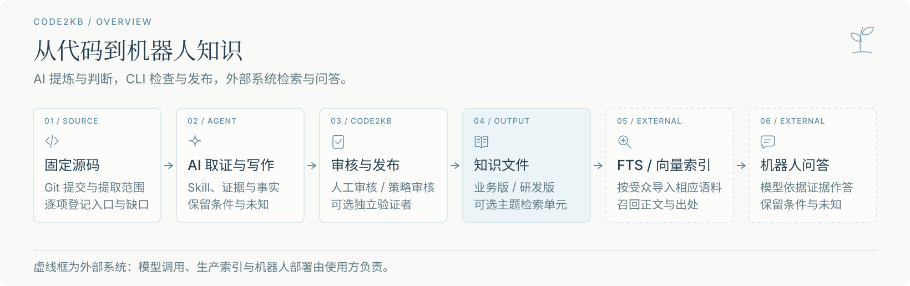
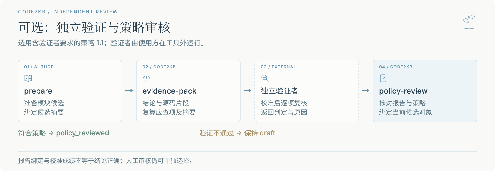
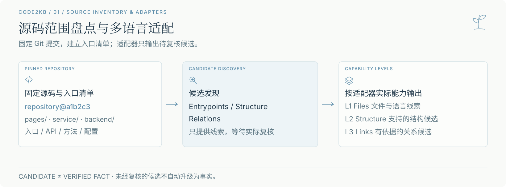
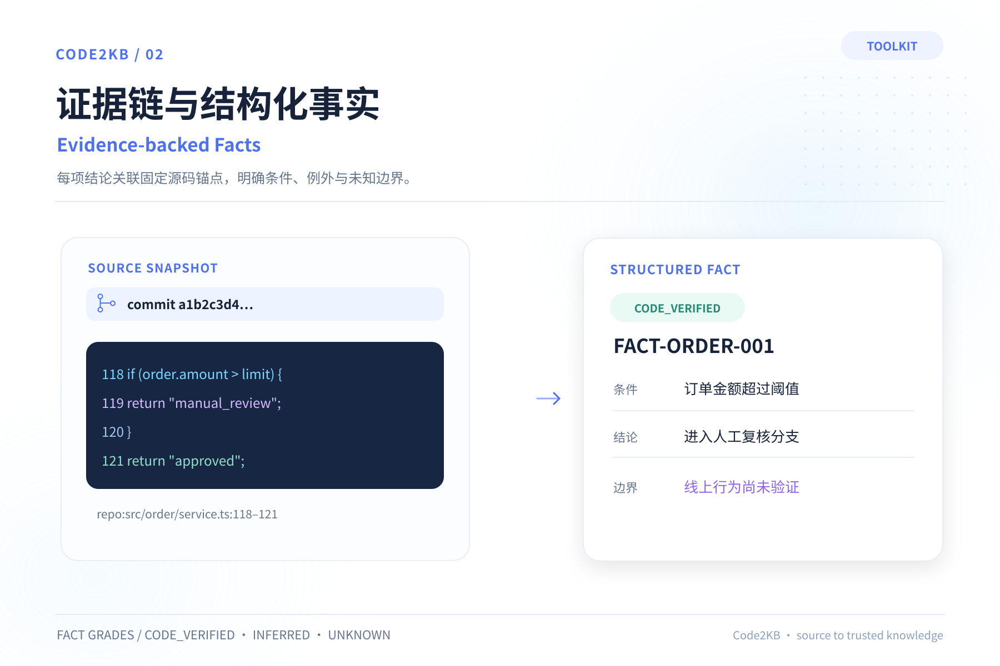
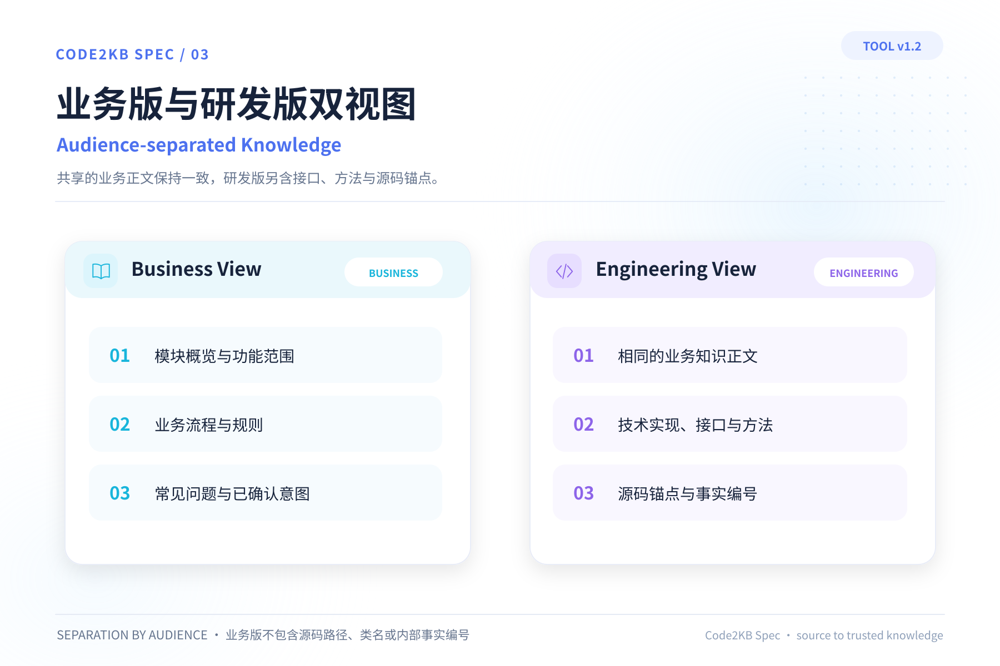
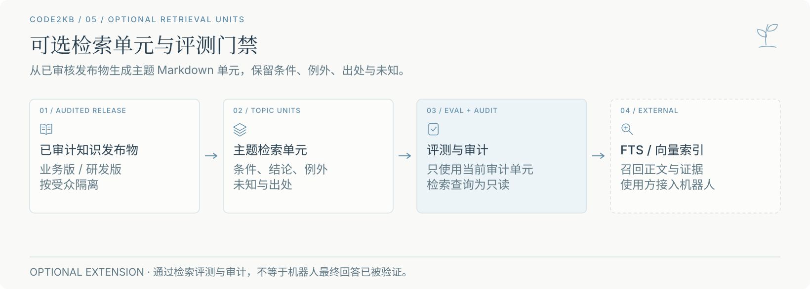
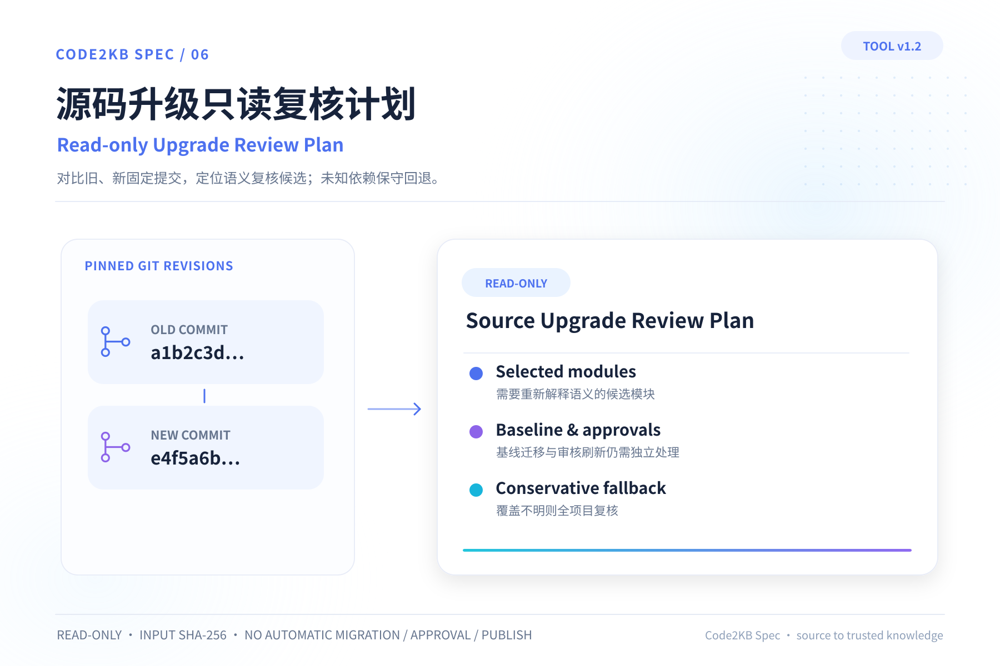

# Code2KB Spec

**简体中文** · [English](README.en.md)

**借助 AI 从代码提炼业务知识，让机器人有据可答。**

Code2KB Spec 将 Agent Skill、开放知识规范和 Python CLI 组合成可复核的知识生产流程。你选用的 AI 编码助手负责阅读源码、提炼业务与实现逻辑；`code2kb` 负责检查证据绑定、审核记录和发布产物。

[快速开始](#快速开始) · [知识产物](#知识产物) · [独立验证](#独立验证12) · [文档](#文档)



## 知识产物

| 产物 | 给谁使用、包含什么 |
| --- | --- |
| **知识源** | 维护者使用：功能大纲、结构化事实、业务与研发草稿、待确认事项 |
| **业务版与研发版** | 业务版提供功能、流程、规则与问答；研发版补充实现、接口、方法和源码锚点。版本清单与指针用于核对版本 |
| **可选检索版** | 外部索引使用：从已审核正文生成的主题单元，保留条件、例外、未知和出处，并附独立评测与审计信息 |

业务机器人可用 **FTS 或向量检索 → 召回正文 → 模型组织答案**。本项目的受审计导入路径是[检索扩展](docs/retrieval-contract.md)；业务机器人只导入业务单元，内部规格和过程文件不进入语料。直接拆分基础业务版建立自有索引时，分块边界、受众隔离、版本切换和评测由使用方负责。

[PetClinic 公开案例](conformance/public-source/petclinic/README.md)记录了从固定源码到业务知识，再到 [SQLite FTS5 召回](conformance/public-source/petclinic/fts5-run.json)的演练。它验证证据定位，尚未验证机器人最终回答。`retrieval-query` 同样只返回候选证据。

## 快速开始

需要 **Git、Python 3.9+**，以及能读取本机仓库的 AI 编码助手。CLI 修改类命令依赖 `fcntl` 文件锁，适用于 Linux／macOS 等提供该模块的平台；缺少该模块的平台仍可运行只读检查。

### 1. 安装并固定源码版本

```bash
git clone https://github.com/Ethereal-Space-one/code2kb-spec.git
cd code2kb-spec
python3 -m pip install -e .
git init /path/to/knowledge-project
cp templates/知识库配置.example.json /path/to/knowledge-project/知识库配置.json
git -C /path/to/source-repo rev-parse HEAD
```

知识项目与源码仓库分开存放。编辑 `知识库配置.json`，删去不用的示例仓库，为每个 `repositories` 条目填写本机仓库绝对路径 `path` 和固定提交 SHA `commit`。

### 2. 让 AI 提取知识

将下面的任务交给 AI 编码助手：

```text
请读取 <code2kb-spec-root>/skills/extract-app-knowledge/SKILL.md。
目标是为 /path/to/knowledge-project 建立源码业务知识库。
先核对固定提交并建立完整功能大纲，再逐模块取证、写作和复核。
保留条件和未知，不把源码推断写成线上结果；按项目选定的审核流程推进，发布前核对授权。
```

Skill 按阶段加载取证、写作与复核手顺；AI 的模型和执行环境由使用方提供。

### 3. 检查、审核并发布

```bash
code2kb check --project-root /path/to/knowledge-project
```

按模块完成 `impact`、`confirm-claims` 和 `prepare` 后，选择审核方式：

| 方式 | 条件与入口 |
| --- | --- |
| **人工审核** | 实际审核人明确批准候选和边界后，用 `approve` 记录决定 |
| **预授权策略审核** | 已有有效策略和本次审核记录时，用 `policy-review` 核对；超范围或命中人工门禁的包保持草稿 |

`check` 通过或 AI 自检不会自动批准。审核通过后发布并审计：

```bash
code2kb publish --project-root /path/to/knowledge-project --release-id my-kb-v1
code2kb audit-release --project-root /path/to/knowledge-project
```

完整参数、审核记录和发布手顺见[使用指南](docs/usage.md)。

<details>
<summary>只想先体验文件结构？运行内置示例</summary>

```bash
python3 -B examples/create_demo.py
```

脚本在临时目录建立小型源码仓库和知识项目，执行 `check` 并打印路径。它展示文件结构和检查流程，不调用模型或自动生成完整知识库。

</details>

## 独立验证（1.2）

可选的独立验证者检查“结论是否被引用源码支持”，也可按验证类型回放问答或检查业务文件披露边界。`evidence-pack` 导出应查项；验证者由使用方运行并返回报告，`code2kb` 核对候选、覆盖、摘要与声明身份。



策略 `1.1` 可要求验证者先通过 `verifier-calibrate` 的注入错误题校准。校准成绩不证明真实项目的判断正确率；验证不通过时模块保持草稿，人工审核仍可单独选择。[查看独立验证者手顺](docs/usage.md#可选独立验证者12)。

## 扩展与维护

- **[长任务接续](docs/0.6.0-runner.md)**：本地任务账本、检查点和恢复命令，提供 [Claude Code](hosts/claude-code/README.md)／[Codex](hosts/codex/README.md) 任务指令适配。
- **[源码升级复核](docs/1.0.0-public-contract.md)**：比较固定提交，输出需复核的知识范围与缺口的只读计划，供维护者修订。
- **[源码适配器](docs/adapter-contract.md)**：输出待复核的入口与关系候选；没有专用分析器的语言使用 L1 文件级降级。

<details>
<summary>查看源码盘点、证据与双版结构（3 张）</summary>

图中的代码、文件名和事实编号仅用于说明结构。







</details>

<details>
<summary>查看可选检索与源码升级复核（2 张）</summary>





</details>

## 文档

[使用指南](docs/usage.md) · [知识文件规范](SPEC.md) · [检索契约](docs/retrieval-contract.md) · [保证范围](docs/assurance-matrix.md) · [版本与兼容性](docs/versioning.md)

源码不能单独证明线上行为、业务政策或授权结果；缺少证据时须保留未知。模型调用、生产 FTS／向量服务和机器人部署由使用方负责。

当前工程 **1.2.0**；新项目默认文件协议为 `c2kb-file/1`，旧 `0.8.3` 项目仍受支持。详见[变更记录](CHANGELOG.md)与[路线图](ROADMAP.md)。

[反馈问题](https://github.com/Ethereal-Space-one/code2kb-spec/issues) · [参与贡献](CONTRIBUTING.md) · [Apache License 2.0](LICENSE)
